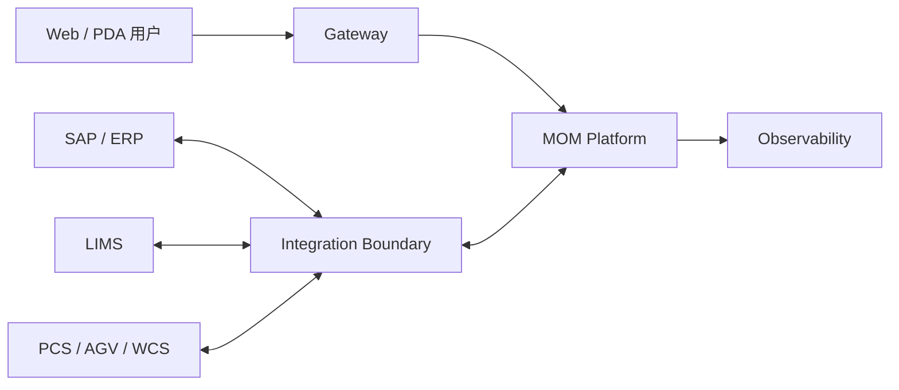

# 系统上下文

MOM Platform 位于 ERP 与车间设备/仓储控制系统之间，通过 Web/PDA 为内部用户提供制造运营能力，通过 Integration Boundary 连接 SAP、LIMS、PCS 和 AGV/WCS。

## 信任边界

- 用户请求经 Gateway 清洗后，由目标 Resource Server 验证 Redis Opaque Token 和权限。
- MOM 内部同步调用使用 `*-client + mom-openfeign`，下游独立认证。
- 外部系统不得继承用户 Bearer、调用内部 Feign 契约或直接访问领域数据库。
- Scheduler、MQ Consumer 等后台执行没有用户请求时不自动生成身份。

## 数据边界

- 服务只写自身 Schema，禁止跨 Schema 业务 JOIN。
- 跨域状态通过 API、事件或明确查询投影传播。
- 当前已实现与仍为规划的能力见 [当前实现地图](../当前实现地图.md)。
